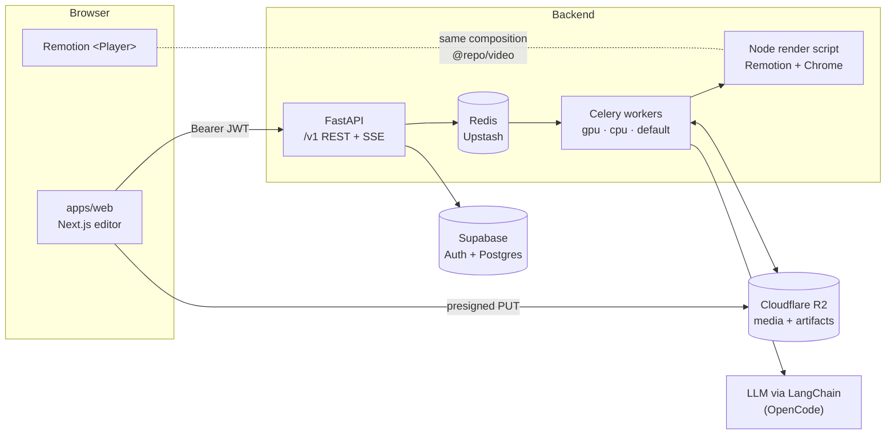

<div align="center">

# ✂️ ClipPro

**Turn long videos into short, captioned vertical clips, with AI picking the best moments.**

Upload a podcast, interview, talk or tutorial. ClipPro transcribes it, has an LLM pick the strongest
20–60 second moments, reframes them to 9:16, and adds word-synced animated captions, so the clips are
ready for TikTok, Instagram Reels and YouTube Shorts.


[Features](#-features) · [How it works](#-how-it-works) · [Tech stack](#-tech-stack) ·
[Getting started](#-getting-started) · [Roadmap](#-roadmap) · [Contributing](#-contributing)

</div>

---

## 💡 Why ClipPro?

Long videos are full of good moments, but cutting them into shorts by hand takes a long time: you
scrub through the video, find the hook, crop to vertical, time the captions word by word, and export.
Hosted "AI clipper" services do this for you, but they cost money per minute, are closed source, and
send your whole video to a third party.

ClipPro is an open alternative built on a few principles:

- **The LLM reasons over text only.** It sees transcript sentences and candidate IDs, never the video
  and never raw timestamps (LLMs make timestamps up). Cuts are validated in code and snapped to word
  boundaries.
- **The preview is the render.** The editor plays the same React/Remotion composition, with the same
  props, that the worker renders to MP4. What you see in the browser is what you download.
- **Every stage can be resumed.** Each pipeline stage writes an artifact and skips itself if that
  artifact exists. If a worker dies, the job continues from the last finished stage.
- **Render only what you use.** Clips are previewed live from the source video. Only the top few are
  pre-rendered, and the rest render when you download them.
- **Not tied to one provider.** You can swap the LLM, the speech-to-text engine and the storage
  through configuration.

## ✨ Features

### 🎬 The clipper (`apps/web` + `apps/server`)

- **Upload or paste a URL.** mp4 / mov / mkv / webm, with presigned direct-to-storage uploads for
  large files and yt-dlp ingest from a URL (SSRF-guarded, requires a rights attestation).
- **Choice of speech-to-text engine:** Moondream Parakeet Redux (local), AssemblyAI (hosted) or
  faster-whisper with silero VAD. You set it in `stt.toml`, which is re-read on every job, so no
  restart is needed.
- **LLM highlight detection.** Sentence-aligned candidate windows, a cheap prefilter, then structured
  LLM scoring against a rubric (hook, self-contained, emotion, payoff, shareability). Free-text
  steering such as *"focus on the funny moments"*. Results are cached, and each job has a budget cap.
- **9:16 reframing:** a center crop, or a wide layout (full frame over a blurred copy of itself).
- **Animated captions** with six presets (`bold_highlight`, `clean`, `karaoke`, `boxed`, `impact`,
  `subtle`). Per clip you can tweak font, size, colors, outline, box, uppercase, words per line,
  position and highlight mode. Fonts are bundled Google Fonts, so renders look the same on every
  machine.
- **Clip editor.** Trim (snapped to words), restyle and change the layout with a live Remotion
  preview, then re-render one clip without re-running the pipeline.
- **Live progress** over Server-Sent Events, polling or signed webhooks.
- **Workspaces** with owner / admin / member roles, team invites and API keys for integrators.
- **Exports:** MP4 clips, thumbnails and caption files.

### 🧰 Free in-browser tools (`apps/main-site`)

The marketing site also hosts 20+ free tools. **They all run in the visitor's browser** (WebCodecs via
Mediabunny, Whisper via transformers.js, canvas), so nothing is uploaded to our servers:

| Transcription & subtitles | Editing & conversion | Downloaders |
|---|---|---|
| Audio/video to text · Subtitle generator | Resize · Crop · Trim · Rotate · Merge · Speed · Loop · Compress · Volume booster · Add text | YouTube thumbnail · YouTube video · YouTube Shorts · Instagram |
| | Video → GIF · WebP · MP3 · Extract frame | TikTok *(coming soon)* |

## ⚙️ How it works

```
 Ingest ──▶ Transcribe ──▶ Highlight detection ──▶ [per clip] Reframe ──▶ Captions ──▶ Render ──▶ Deliver
 ffprobe     Parakeet /      candidates → prefilter      crop path         word-level     Remotion     R2 + signed
 yt-dlp      AssemblyAI /    → LLM scoring (IDs only)    (center / wide)   timings        + ffmpeg     URLs, webhooks
 16k WAV     Whisper         → validate & select                                          loudnorm
```



**Shared composition.** `packages/video` holds the Remotion `ClipComposition` and the caption config.
The web editor imports it into a `<Player>`, and the Celery render task shells out to
`packages/video/scripts/render.mjs` to render the **same component with the same props**. ffmpeg only
does the loudness pass and the thumbnails.

**Reliability.** Tasks use `acks_late` and `reject_on_worker_lost`. A heartbeat thread and a beat task
requeue stale jobs. Failures record `{code, message, stage, retryable}`, and transient errors retry
with backoff. Every LLM call's tokens, cost and latency are logged in `llm_runs`.

## 🧱 Tech stack

| Layer | Technology |
|---|---|
| **Monorepo** | [Turborepo](https://turborepo.dev) · pnpm workspaces · TypeScript |
| **Web app** | Next.js 16 · React 19 (React Compiler) · Tailwind CSS 4 · shadcn/ui + Radix · TanStack Query · `openapi-fetch` (types generated from the API schema) · next-themes |
| **Marketing site** | Next.js 16 · Tailwind 4 · Mediabunny · transformers.js · Pyodide + yt-dlp (in a worker) |
| **Video rendering** | [Remotion](https://www.remotion.dev) 4 (`@remotion/player`, `@remotion/renderer`, Google Fonts) · ffmpeg |
| **API** | FastAPI · Pydantic Settings · SQLAlchemy 2 (async) + Alembic · structlog |
| **Workers** | Celery with separate `gpu` / `cpu` / `default` queues · Redis (Upstash) |
| **AI** | LangChain (`init_chat_model`) through OpenCode: `claude-haiku-5-5` with a `deepseek-v4-flash` fallback, or a deterministic heuristic scorer when no model is set |
| **Speech-to-text** | Moondream Parakeet Redux · AssemblyAI · faster-whisper + silero VAD |
| **Auth & DB** | Supabase Auth (email + password, JWKS verification) · Supabase Postgres (private `app` schema, RLS) |
| **Storage** | Cloudflare R2 (S3 API) |
| **Tooling** | uv · Ruff · mypy · pytest (+ moto) · ESLint · Prettier · Docker |

## 📁 Project structure

```
clip-pro/
├── apps/
│   ├── web/          # The ClipPro app: auth, dashboard, upload, job progress, clip editor, settings
│   ├── server/       # FastAPI API + Celery pipeline (Python, managed by uv)
│   ├── main-site/    # Marketing site, SEO pages and free in-browser video tools
│   └── docs/         # Docs site (placeholder)
├── packages/
│   ├── video/        # Shared Remotion composition, caption presets, bundle + render scripts
│   ├── ui/           # Shared React components
│   ├── eslint-config/
│   └── typescript-config/
├── docs/plans/       # Design docs for upcoming features
├── requirements.md   # Full product and pipeline specification
└── watch.py          # CPU/RAM monitor for each component (api, worker, web, Chrome, ffmpeg…)
```

## 🚀 Getting started

### Prerequisites

- **Node.js ≥ 24** and **pnpm 11**
- **Python 3.12+** and [**uv**](https://docs.astral.sh/uv/)
- **ffmpeg** / ffprobe
- Cloud accounts (all have free tiers): a [Supabase](https://supabase.com) project, an
  [Upstash](https://upstash.com) Redis database and a [Cloudflare R2](https://developers.cloudflare.com/r2/) bucket
- *Optional:* an [OpenCode](https://opencode.ai) API key for LLM scoring and an
  [AssemblyAI](https://www.assemblyai.com) key for hosted transcription

### 1. Install

```bash
git clone https://github.com/adwaitgawade/cliper-ai.git clip-pro
cd clip-pro
pnpm install
```

### 2. Configure

```bash
cp apps/server/.env.example apps/server/.env   # Supabase, Upstash, R2, LLM and STT keys
cp apps/web/.env.example    apps/web/.env.local # Supabase URL + publishable key, API URL
```

- **Supabase:** turn on email auth, and add `http://localhost:3000/auth/confirm` under
  *Auth → URL Configuration → Redirect URLs*. Use the *Session pooler* connection string.
- **R2:** allow CORS `GET` and `PUT` from your web origin, because the browser uploads to and plays
  from the bucket directly.
- **Speech-to-text:** pick `redux`, `assemblyai` or `whisper` in `apps/server/stt.toml`.

### 3. Set up the database

```bash
pnpm --filter server setup     # uv sync + alembic upgrade head
```

### 4. Run

```bash
pnpm dev                       # everything, through Turborepo
```

Or run each piece on its own:

```bash
pnpm --filter server dev       # API on :8000 (docs at /docs) + Celery worker + beat
pnpm --filter web dev          # app on http://localhost:3000
pnpm --filter main-site dev    # marketing site (pass --port if 3000 is taken)
pnpm --filter @repo/video studio   # Remotion Studio for the clip composition
```

> Remotion downloads Chrome Headless Shell the first time it renders. On macOS the Celery worker
> runs with `-P threads`, because the prefork pool fails under the spawn start method.

### Docker

The API and workers can run in containers. Infrastructure stays in the cloud and is configured in `.env`:

```bash
cd apps/server && docker compose up -d --build
```

The images are built from the repository root, because the worker image includes `packages/video`,
Node and Chrome.

## 🔌 API at a glance

All routes are under `/v1`, and the interactive OpenAPI docs are at `/docs`. Authenticate with a
Supabase access token (`Authorization: Bearer …`) or a workspace API key (`X-API-Key: cp_…`).

```bash
# 1. Ingest a video from a URL
curl -X POST $API/v1/videos/from-url -H "X-API-Key: $KEY" -H "Content-Type: application/json" \
  -d '{"url": "https://…", "rights_attested": true}'

# 2. Start the pipeline
curl -X POST $API/v1/jobs -H "X-API-Key: $KEY" -H "Content-Type: application/json" \
  -d '{"video_id": "…", "options": {"num_clips": 8, "instructions": "focus on the funny moments"}}'

# 3. Stream progress, then fetch the clips
curl -N $API/v1/jobs/$JOB/events -H "X-API-Key: $KEY"
curl    $API/v1/jobs/$JOB/clips  -H "X-API-Key: $KEY"
```

The full endpoint list, caption options and reliability model are in
[`apps/server/README.md`](apps/server/README.md).

## 🧪 Development

```bash
pnpm lint                      # ESLint + Ruff, across the workspace
pnpm check-types               # tsc + mypy
pnpm --filter server test      # pytest (unit + integration; needs local Postgres and ffmpeg)
pnpm --filter server test:slow # also runs a real speech model end to end
pnpm --filter web gen:api      # regenerate the typed API client after changing the server
python3 watch.py --watch 2     # live CPU/RAM per component
```

## 🗺️ Roadmap

The full specification is in [`requirements.md`](requirements.md). **M1 (the MVP) is done.** Coming next:

- [ ] **M2:** scene detection, face detection and tracking, a smoothed speaker-following crop
- [ ] **M3:** speaker diarization, active-speaker detection, mapping speakers to faces
- [ ] **M4:** LLM-written titles, descriptions and hashtags, face-based thumbnails, replacement clips
- [ ] **M5:** Prometheus metrics, a dead-letter queue, load tests, an audio-visual ASD model
- [ ] **1-click social publishing** to YouTube, Instagram and TikTok
  ([plan](docs/plans/social-publishing.md))
- [ ] **Agentic editor:** a separate, chat-driven editor ("remove all fillers", "add captions")

## 🤝 Contributing

Contributions are welcome! To contribute:

1. Fork the repo and create a branch: `git checkout -b feat/my-feature`
2. Make your change, and run `pnpm lint`, `pnpm check-types` and the server tests
3. If you changed the API, run `pnpm --filter web gen:api` and commit the regenerated types
4. Open a pull request that explains what you changed and why

For bugs and feature ideas, please [open an issue](https://github.com/adwaitgawade/cliper-ai/issues).

## 📄 License

No license has been chosen for this project yet.

> **A note on Remotion:** rendering uses [Remotion](https://www.remotion.dev), which is free for
> individuals and companies of up to three people. Larger teams, and anyone running ClipPro as a
> commercial SaaS, need a [Remotion company license](https://remotion.dev/license).

## 🙏 Acknowledgements

ClipPro is built on [Remotion](https://www.remotion.dev), [FastAPI](https://fastapi.tiangolo.com),
[Celery](https://docs.celeryq.dev), [LangChain](https://www.langchain.com), [Supabase](https://supabase.com),
[faster-whisper](https://github.com/SYSTRAN/faster-whisper), [Moondream](https://moondream.ai),
[AssemblyAI](https://www.assemblyai.com), [yt-dlp](https://github.com/yt-dlp/yt-dlp),
[Mediabunny](https://mediabunny.dev), [transformers.js](https://huggingface.co/docs/transformers.js),
[ffmpeg](https://ffmpeg.org) and [shadcn/ui](https://ui.shadcn.com).

<div align="center">
<sub>Made by <a href="https://github.com/adwaitgawade">Adwait Gawade</a>.</sub>
</div>
